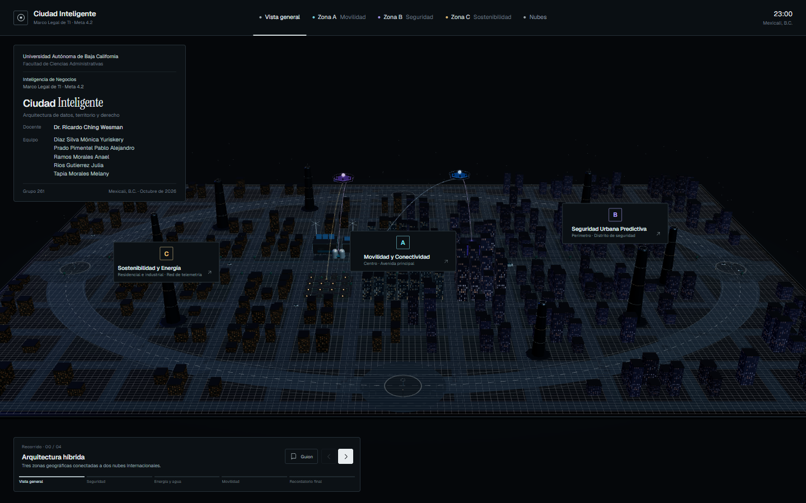

# Ciudad Inteligente

**Universidad Autónoma de Baja California** · Facultad de Ciencias Administrativas  
Inteligencia de Negocios · **Marco Legal de TI** · Actividad **Meta 4.2** · Grupo **261**  
Docente: **Dr. Ricardo Ching Wesman** · Mexicali, B.C. · octubre de 2026

Un recorrido 3D por una ciudad conectada: tres zonas geográficas, dos nubes internacionales y cuatro capas de lectura jurídica. El modelo reúne movilidad, seguridad urbana, energía y agua en un mismo territorio, con la infraestructura, los riesgos, el marco legal y la propiedad intelectual de cada sector.




## El recorrido

| Paso | Escena | Contenido |
| --- | --- | --- |
| 00 | Vista general | Tres zonas y arquitectura híbrida (Edge en México y nubes en EE. UU. y la UE) |
| 01 | Seguridad urbana predictiva | Zona B y Nube EE. UU.: biometría, drones, EIPD y secreto industrial |
| 02 | Sostenibilidad y energía | Zona C y Nube UE: telemetría domiciliaria, GDPR y transferencia internacional |
| 03 | Movilidad y conectividad | Zona A: semáforos, Wi-Fi/5G, datos abiertos y obra por encargo |
| 04 | Recordatorio final | Ficha del proyecto con docente e integrantes |

Abre **Guion** en la barra de recorrido para consultar las notas de exposición.

## La ciudad

- **Ciudad continua de gran formato**: más de 480 × 300 unidades de trama urbana, con tres macro sectores integrados (A, B y C), calles, avenidas y manzanas que conectan todo el territorio.
- **Zona A**: semáforos con sensores, cámaras LPR, transporte autónomo y paradas con Wi-Fi 6 / 5G.
- **Zona B**: cámaras PTZ con reconocimiento facial, drones de patrullaje, arcos lectores y centro de seguridad.
- **Zona C**: vivienda, medidores inteligentes, red de agua, subestación eléctrica, paneles solares y aerogeneradores.
- **Diseño urbano**: anillo perimetral con cuatro glorietas, torres de formas cónicas y fachadas luminosas diferenciadas por sector.
- **Movilidad**: transporte autónomo, vehículos particulares y patrullaje aéreo en movimiento.
- **Nubes internacionales**: enlaces visuales entre la infraestructura de borde y los centros de cómputo de EE. UU. y la Unión Europea.
- **Rendimiento**: geometría instanciada, texturas procedurales, vehículos ligeros y una interfaz sin efectos de postprocesado.

## Controles

- Arrastra para orbitar la ciudad; usa la rueda o la pinza para acercar.
- Haz clic en una etiqueta de zona o de nube para abrir su ficha.
- Cambia entre **Infraestructura**, **Riesgos**, **Marco legal** y **Propiedad intelectual** desde la ficha de cada zona.
- Usa el recorrido guiado para seguir el orden de la exposición.
- La ficha académica permanece visible en la esquina superior izquierda.
- La hora del encabezado corresponde a **Mexicali, B.C.**

## Desarrollo local

Requisitos: **Node.js 20.19 o superior**.

```bash
npm install
npm run dev
```

Abre `http://localhost:5173`.

```bash
npm run build     # compila TypeScript y genera /dist
npm run preview   # sirve la build de producción
```

## Deploy en Vercel

El proyecto ya está preparado para Vercel como sitio estático. Incluye [`vercel.json`](vercel.json) con framework Vite, comando de build y carpeta de salida.

### Opción A — desde el panel de Vercel

1. Importa el repositorio en Vercel.
2. Verifica:
   - **Framework Preset:** Vite
   - **Build Command:** `npm run build`
   - **Output Directory:** `dist`
3. **Deploy**. No se necesitan variables de entorno.

### Opción B — con la CLI

```bash
npx vercel
npx vercel --prod
```

La app es una sola página estática: no requiere API ni backend.

[](https://vercel.com/new/clone?repository-url=https://github.com/Anael19-gg/ciudad-inteligente)

## Contenido y estructura

- **Zonas, nubes, textos legales y guion:** [`src/data/project.ts`](src/data/project.ts)
- **Ciudad, edificios, vialidades y mobiliario:** [`src/components/scene`](src/components/scene)
- **Portada, navegación, fichas y recorrido:** [`src/components/ui`](src/components/ui)
- **Texturas procedurales:** [`src/lib/textures.ts`](src/lib/textures.ts)
- **Sistema visual:** [`src/styles/global.css`](src/styles/global.css) y [`src/styles/professional.css`](src/styles/professional.css)
- **Portada y metadatos:** [`public/og-cover.png`](public/og-cover.png)

La ficha académica toma los datos de `PROJECT` en `src/data/project.ts`. Para actualizar el docente, el equipo, el grupo o la fecha, edita ese objeto y vuelve a desplegar.

## Stack

- Vite + React 19 + TypeScript
- Three.js con React Three Fiber y Drei
- Fontsource: Geist e Instrument Serif

---

**Equipo**

- Díaz Silva Mónica Yuriskery
- Prado Pimentel Pablo Alejandro
- Ramos Morales Anael
- Rios Gutierrez Julia
- Tapia Morales Melany

Facultad de Ciencias Administrativas · Universidad Autónoma de Baja California  
Mexicali, B.C. · octubre de 2026
