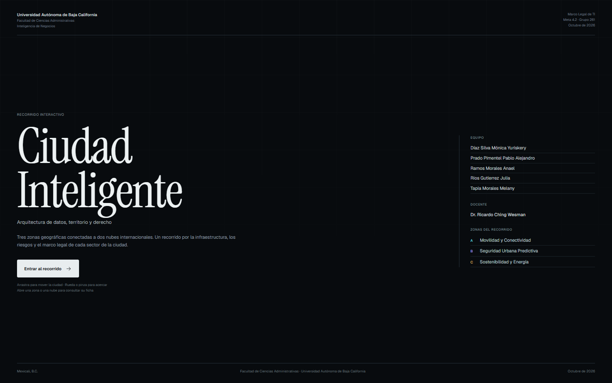

# Ciudad Inteligente

**Atlas 3D interactivo de datos, territorio y derecho.**

Un recorrido navegable por una ciudad conectada: tres distritos instrumentados, dos nubes internacionales y cuatro capas de lectura jurídica. Cada infraestructura, riesgo, norma y activo de propiedad intelectual está enlazado a su evidencia dentro del modelo.



## Qué incluye

- **Modelo 3D navegable** de una ciudad diorama: avenida principal, distrito de seguridad, zona residencial e industrial, red de agua y energía, semáforos, LPR, transporte autónomo, drones y cámaras PTZ.
- **Arquitectura híbrida visualizada**: nube de EE. UU. conectada a las zonas A y B; nube de la Unión Europea conectada a la zona C, con flujos animados de datos.
- **Cuatro capas de lectura** por distrito:
  - Infraestructura y flujo (hardware, edge, procesamiento, operadores).
  - Riesgos y privacidad (Art. 16° y 6° CPEUM, datos sensibles).
  - Marco legal aplicable (LFPDPPP, LGPDPPSO, T-MEC, CCPA/CPRA, GDPR y SCCs).
  - Propiedad intelectual (LFDA, LFPPI, patentes, modelos de utilidad y secreto industrial).
- **Recorrido guiado** de cinco pasos con guion de exposición para clase.
- **Ficha del proyecto** visible en el lienzo, con docente, equipo y fecha. Se puede editar directamente en la página y queda guardada en el navegador.
- **Diseño responsive** y preferencias de movimiento reducido.

## Contenido del recorrido

| Paso | Escena | Lectura |
| --- | --- | --- |
| 00 | Vista general | Tres distritos, dos nubes y el rol dual de operadores |
| 01 | Seguridad urbana predictiva | Biometría, drones, EIPD y secreto industrial |
| 02 | Sostenibilidad y energía | Telemetría domiciliaria, GDPR y transferencia internacional |
| 03 | Movilidad y conectividad | Semáforos, Wi-Fi/5G, datos abiertos y obra por encargo |
| 04 | Cierre | La ciudad se habita con derechos |

Abre **Guion** dentro de la barra de recorrido para ver las notas de exposición.

[](https://vercel.com/new/clone?repository-url=https://github.com/Anael19-gg/ciudad-inteligente)

## Cómo usarlo

- Arrastra para orbitar, rueda o pinza para acercar y clic derecho o dos dedos para desplazar.
- Toca las etiquetas de zona, las nubes o las balizas de color para abrir su ficha.
- Filtra las balizas con las capas de la esquina inferior izquierda.
- Usa **Editar** en la tarjeta *Ficha del proyecto* para escribir los nombres reales del equipo.

## Desarrollo local

Requisitos: **Node.js 20 o superior**.

```bash
npm install
npm run dev
```

Abre `http://localhost:5173`.

```bash
npm run build     # compila TypeScript y genera /dist
npm run preview   # sirve la build de producción
```

## Deploy en Vercel

El proyecto ya está preparado para Vercel como sitio estático. Incluye [`vercel.json`](vercel.json) con framework Vite, comando de build y carpeta de salida.

### Opción A — desde el panel de Vercel

1. Sube el repositorio a GitHub.
2. En Vercel, **Add New → Project** e importa el repositorio.
3. Vercel detecta Vite. Verifica:
   - **Framework Preset:** Vite
   - **Build Command:** `npm run build`
   - **Output Directory:** `dist`
4. **Deploy**. No se necesitan variables de entorno.

### Opción B — con la CLI

```bash
npx vercel
npx vercel --prod
```

La app es una sola página estática: no requiere rewrites, API ni backend.

## Personalización

- **Créditos y equipo:** la ficha ya incluye al docente y al equipo del proyecto. Se puede editar en pantalla o en `PROJECT` dentro de [`src/data/project.ts`](src/data/project.ts).
- **Todo el contenido legal, zonas, nubes y guion:** [`src/data/project.ts`](src/data/project.ts).
- **Ciudad, edificios y mobiliario:** [`src/components/scene`](src/components/scene).
- **Interfaz, panel, recorrido y ficha:** [`src/components/ui`](src/components/ui).
- **Sistema visual:** [`src/styles/global.css`](src/styles/global.css).

> **Nota:** la ficha del proyecto incluye al docente y a los cinco integrantes del equipo. Si necesitas actualizarlos, usa el botón **Editar** o modifica `PROJECT.team` en `src/data/project.ts` y vuelve a desplegar para que el cambio sea permanente en Vercel.

## Stack

- [Vite](https://vite.dev/) + React 19 + TypeScript
- [Three.js](https://threejs.org/) con [React Three Fiber](https://docs.pmnd.rs/react-three-fiber) y [Drei](https://github.com/pmndrs/drei)
- [postprocessing](https://github.com/pmndrs/postprocessing) para bloom y viñeta
- [Fontsource](https://fontsource.org/) — Geist e Instrument Serif

## Estructura

```
src/
  data/project.ts          Contenido, zonas, nubes, capas y guion
  components/
    scene/                 Modelo 3D, nubes, balizas, cámara y ciudad
    ui/                    Portada, navegación, panel, recorrido y ficha
  lib/textures.ts          Texturas procedurales (ventanas, asfalto, sol)
  styles/global.css        Sistema de diseño y responsive
public/
  favicon.svg
  og-cover.png
docs/
  preview-intro.png
```

---

Proyecto académico · **Dr. Ricardo Ching Wesman** · 24 de noviembre de 2026

**Equipo:** Anael Ramos Morales · Pablo Alejandro Prado Pimentel · Melany Tapia Morales · Mónica Yuriskery Díaz Silva · Julia Rios Gutierrez
